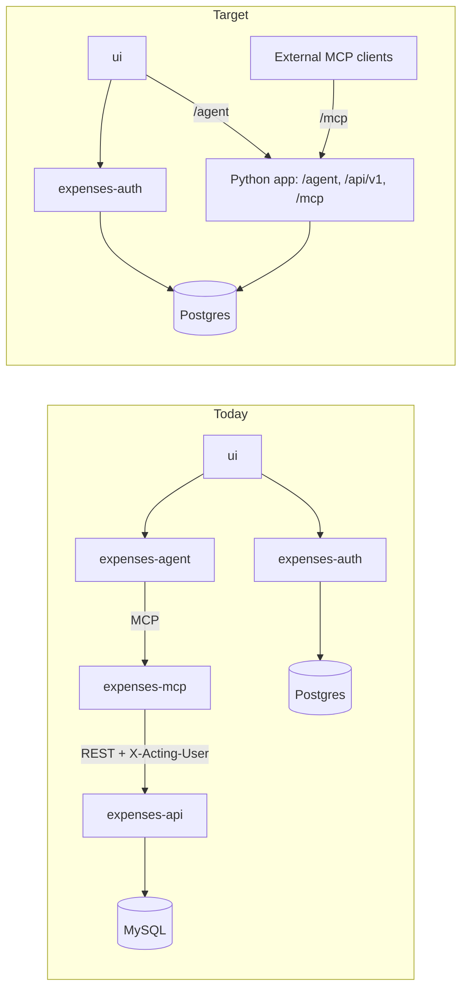

# Architecture: current state and target

The agent, the MCP server and the REST API merge into one Python app on one Postgres database. The system goes from five services and two database engines to three services and one. After that, the work closes gaps in the product loop: corrections, confirmation, deduplication and reporting computed in SQL.

This is the agreed plan. Each task is a GitHub issue, linked below; the issues hold the acceptance criteria. Findings come from reading the code at commit `082441f`.

## Today and target



In the target, the agent's tools reach the service layer by function call instead of two network hops. `expenses-auth` stays through Phases 1 to 3, issuing user tokens only; in Phase 4, WorkOS AuthKit replaces it (D5), leaving `ui` and the app. External MCP clients use the app's `/mcp` route, which serves the same tool functions the agent calls.

## What changes

Most of the change is deletion: the MCP hop, service-to-service tokens, the schema copy and the second database engine all go away.

| Area | Today | Target | Evidence |
| --- | --- | --- | --- |
| Services | Five: ui, expenses-agent, expenses-mcp, expenses-api, expenses-auth | Three: ui, one Python app, expenses-auth; then two, once WorkOS AuthKit replaces expenses-auth | `README.md` |
| Tool calls | Each call opens an MCP session, then a REST request, then SQL | A function call into the service layer; the same functions are served at `/mcp` for external clients | `expenses-agent/src/graph.py:24`, `expenses-mcp/src/tools.py` |
| Schemas | `expenses-mcp/src/types.py` copies the API schemas | One definition | `expenses-api/schemas/schema.py` |
| User identity | `X-Acting-User` header, vouched for by service tokens that can act as any user | The user's JWT verified once; `user_id` passed as a required argument | `expenses-api/core/security.py:43`, `expenses-mcp/src/auth.py:46` |
| Auth-off mode | `AUTH_REQUIRED=false` gives unscoped repositories | Resolves to the dev user; the user id is never optional | `expenses-api/api/deps.py:23` |
| Databases | MySQL for expenses, Postgres for auth | One Postgres | `expenses-api/config/db_config.py`, `expenses-auth/internal/store/postgres.go` |
| Conversation state | In process memory; lost on every deploy | Postgres checkpointer with bounded history | `expenses-agent/src/graph.py:39` |
| LLM throughput | With DeepSeek, one call per 5 seconds for the whole deployment | No process-wide limiter | `expenses-agent/src/llm.py:29` |
| Money and time | Float amounts, no currency, naive datetimes | `NUMERIC` plus currency, `timestamptz`, date windows in the user's timezone | `expenses-api/db/models.py:32`, `expenses-api/services/services.py:126` |
| Corrections | Create only: no update, delete, confirmation or dedupe | Update and delete tools, confirm before write, unique transaction reference | `expenses-api/api/v1/endpoints/` |
| Reporting | Two fixed totals; other questions pull every row into the model | One SQL-backed query tool | `expenses-api/db/repositories/repositories.py:51` |
| Request logs | Nothing links a request across services; the agent logs whole conversations; expenses-auth logs nothing per request | One console line per request, with a trace id shared by ui, the app and expenses-auth | `expenses-agent/src/nodes.py:41`, `expenses-auth/main.go` |
| Safety net | No agent or MCP tests, Go tests not run in CI, API tests on SQLite only | Tool tests, extraction evals, Postgres in CI | `.github/workflows/lint.yml` |
| Local setup | Five READMEs, no compose file | One `docker compose up` | each service's `.env.example` |

## Decisions

| # | Decision | Outcome | Gates |
| --- | --- | --- | --- |
| D1 | Is showing a zero-trust microservice setup a goal of this project? | Decided: no. The agent, MCP server and REST API merge into one app. | Story 1 (#49) |
| D2 | Is there data in the production MySQL worth keeping? | Decided: yes. Production data is important and must not be lost. It is backed up and migrated, the migration is rehearsed on a copy first, and MySQL stays read-only until every user's counts and totals match. | #71, #72 |
| D3 | Where does an expense's currency come from? | Decided: from the user's default currency. A new user is offered USD on their first expense and must confirm it, or choose another, before anything is saved; their answer becomes the default. Existing users' expenses are RWF, and RWF becomes their default. A currency named in the message applies to that expense only. | #73, #71 |
| D4 | Should external MCP clients be able to log expenses? | Decided: yes. The app serves `/mcp` for external clients; its own chat calls the same tool functions directly. | #59, #65, #66 |
| D5 | How do external MCP clients sign in? | Decided: replace `expenses-auth` with WorkOS AuthKit, which supports Client ID Metadata Documents and dynamic client registration for MCP clients and is free up to 1 million users. Existing users keep their passwords: their argon2id hashes are imported. Sign-out revocation and login throttling come from WorkOS, so #83 and #85 are dropped. | #66, #67, #86 |

## Phases

Sizes and full criteria are in the issues. S is up to half a day, M one to two days, L three or more.

### Phase 0: quick fixes

Small, independent fixes, one pull request each: #92 (uvicorn reload), #93 (Go tests in CI), #94 (stale docs), #95 (MCP timeouts; skip if #65 starts soon), #96 (rate limiter), #78 (pagination), #84 (HTTPS).

### Phase 1: one Python service

Story #49 and the first half of story #50. The agent moves into the API service, tools become plain functions over the services, and everything that carried identity between services is deleted. D1 is decided, so this phase can start.

Order: #58, #59 and #60 in sequence; #65 and #61 once #59 is deployed; #63 last; #62 and #64 at any point.

User tokens carry audience `expenses-agent` and scope `chat` only (`expenses-auth/internal/tokens/tokens.go:32`). Set the merged app's `AUTH_AUDIENCE` to match.

### Phase 2: one Postgres

Stories #52, #53 and #51. Expenses move to Postgres with exact money and timezone-aware timestamps, and conversations survive a redeploy.

Order: #69, #73 and #70 in sequence, then #71 and #72. #74, #33 and #68 are independent; #33 can use the auth Postgres server straight away.

### Phase 3: product loop

Stories #54, #55 and #56. A user can check an expense before it is saved, fix it afterwards, and ask questions the database answers.

Order: #75, #80, #81 and #82 need nothing from Phase 2. #76 and #77 build on the columns from #73, and #79 is simpler after #74.

### Phase 4: hardening and options

Stories #57 and the rest of #50. #67 moves sign-in to WorkOS AuthKit and #66 connects `/mcp` to it; do them together. #86 is easiest alongside #67.

## Request logging

Story #34. Every request prints one line to the server's console, and one trace id ties a request together from `ui` through the app to `expenses-auth`. OpenTelemetry supplies the trace context. There is no collector and nothing is stored beyond the container's own log.

Each line carries method, route template (not the raw URL), status, duration in ms, trace id and the acting user's id. An agent turn adds one line per model call (model, duration, token counts) and per tool call (tool name, duration, ok or error), under the same trace id:

```
request method=POST route=/agent status=200 duration_ms=4210 trace_id=4bf92f35… user_id=00000000-…-0001
```

Never logged: message text, prompts, model output, tool arguments, amounts, merchants, `Authorization` headers, tokens, passwords, emails and query strings.

The trace id travels as a W3C `traceparent` header. `ui` starts it with `@vercel/otel`, which only propagates to URLs listed in `fetch.propagateContextUrls`. The app's FastAPI instrumentation and the Go `otelhttp` handler pick it up, and in-process tool calls inherit it. The line is printed from a span processor; `ConsoleSpanExporter` prints a multi-line JSON block per span, so it stays behind a debug flag.

Order: #87 and #88 now, since neither depends on the merge. #89, #90 and #91 wait for #58 and #59, so there is one Python service to instrument instead of three.
